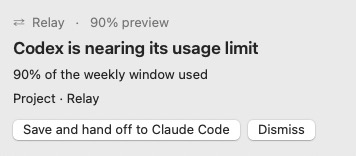

# Relay

Relay is a macOS menu-bar app for people who code with both Codex and Claude Code. It watches the signed-in tools’ usage windows and warns you at **90% used**. With one click, you can ask the current agent to checkpoint its work, save a personal copy of the project, and open the other agent in Terminal **in the same folder**, with instructions to continue.

Imagine you are fixing a failing test. Codex has tried two fixes, ruled one out, and edited a file you haven’t committed. Opening the folder in Claude Code gives it the edit. The checkpoint also tells it which fix failed, which test actually ran, and what to try next. That context is what makes the switch useful. You can also hand off deliberately at a milestone, well before a usage warning.



*The screenshot shows a simulated reading. The handoff button in the preview runs a real save and transfer.*

## Install the Mac beta

This is a source release for people who already use both local coding tools. The tested configuration is Apple silicon, macOS 15.1, Codex CLI 0.151.0, and Claude Code 2.1.323. Use a Codex version with `codex queue` and a Claude Code version with `asyncRewake` hook support. Each tool needs its own signed-in account.

Download the GitHub release's **Source code (zip)**, unzip it, and move the folder somewhere you intend to keep it. Open Terminal in that folder. Building requires Apple's Swift command-line tools and Python 3.9 or later. If the Swift tools are missing, run `xcode-select --install` and finish Apple's installer first.

```sh
./macOS/build.sh && python3 macOS/install-claude-hook.py && open "Relay 2.app"
```

This builds Relay on your Mac and adds its session hooks to your Claude user settings. On a fresh Claude configuration it also installs a silent usage collector. If you have a custom status line, follow [Existing status lines](#existing-status-lines) to connect usage. Start or resume a Claude Code session after setup. Open **⇄ Relay** and confirm that your project, a Codex reading, and a timestamped Claude reading appear.

## Using Relay

1. Open **Relay 2.app** in this project folder. Look for **⇄ Relay** in the macOS menu bar.
2. Work in a local Codex or Claude Code session. Open the Relay menu to see the selected project, usage windows, reset times, and available actions. Hover over the project name to see its full path.
3. Choose **Save and hand off to Claude Code** or **Save and hand off to Codex**. The warning popup offers the same action when Relay can reach a session from the provider that triggered the warning. Choose **Dismiss** to keep working.
4. Leave Relay and the source session running while the menu shows **⇄ Saving…**. After the save, Terminal opens the destination CLI. It receives the checkpoint path and a continuation prompt automatically. A first-time folder trust or tool-permission prompt belongs to the destination CLI.

The destination is a new local CLI session. The original conversation stays available in its own tool. The two agents share the working directory, so a change the destination makes is immediately visible there. This workflow assumes both tools have access to the same local files.

### Choosing the right project and chat

Relay checks roughly every five seconds. It looks at the working directories of local CLI processes and the paths and activity times recorded in local session logs. It ranks live CLI directories first, then recent activity. This is an estimate of which project you are working on. Clicking between editor windows alone may leave the selection unchanged.

- **Switch project** lets you pick another detected folder. **Follow active project** restores automatic selection.
- Within a project, the default handoff uses the most recently active reachable session. If several chats are available, **Hand off another session** lets you choose by provider, activity time, and session ID suffix. The handoff menu item’s tooltip includes the full session ID.
- A folder can appear before a session is reachable. Codex needs an open local session that can receive a queued message. Claude Code needs a session running its Relay handoff hook. With no reachable source, **Copy checkpoint request** provides the manual fallback. Paste it into the source chat and let the agent write the note.
- When a latest note already exists, **Continue in Claude Code…** or **Continue in Codex…** opens it after confirmation. Use this to resume an existing checkpoint. Use **Save and hand off** to capture work done since then.

### Reading the usage warning

| In the Relay menu | How to read it |
| --- | --- |
| Codex usage | Relay queries the signed-in Codex app server about once a minute. It displays the windows the provider returns. For example, `10080m` is seven days. **Refresh usage** requests a fresh Codex reading. |
| Claude Code usage | Claude’s status line supplies the five-hour and seven-day readings when available. **Last seen** is the time of the latest reporting session. An idle Claude session can leave an older reading on screen. |
| **⇄ Relay · 90%+** | At least one eligible window is at or above 90% used. On entering this state, Relay beeps and ordinarily shows a compact panel near the upper-right of the display containing the pointer. The panel lets you keep typing in your current app. |
| **Disconnected** or **awaiting update** | A connection failed, a percentage is missing, or a window has expired. Codex can retain its last rows during a disconnect. Check the connection label and the next refresh. |
| **Earned resets available** | Codex reports the count. Spending one requires choosing **Use one Codex reset…** and confirming. The option appears when Codex is online, an eligible window is high, and a credit is available. Saving and transferring use zero reset credits. |

Percentages describe provider usage windows. They do not tell you how many prompts are left. Relay warns on entry into the overall high-usage state, so dismissing the panel lets you work without a new popup on each poll. A source agent still needs enough capacity to answer the checkpoint request.

## What happens after the click

| Step | What Relay and the agents do |
| --- | --- |
| **Request** | Relay checks the selected project and source session ID. It queues a message to that Codex chat, or signals the listener registered by that Claude Code session. Only one handoff runs at a time. |
| **Checkpoint** | The source is asked to finish its current safe step, pause, and return a Markdown note. The request calls for the objective, acceptance criteria, completed changes, branch and working files, checks actually run, blockers, and the first unfinished step. It asks the agent to omit secrets and raw transcripts. |
| **Save** | Relay watches the source log for a reply carrying this request’s unique markers. It allows up to ten minutes for a complete reply. It prepares a private workspace archive, compares file inventories before and after archiving, and checks the saved note. |
| **Publish** | Relay writes a versioned note in the project and updates the latest-note file. Each handoff has its own timestamped ID, so a later handoff can update the latest note while the earlier version stays readable. |
| **Continue** | Relay opens Terminal in the source folder and starts the opposite CLI with the exact versioned note path. The destination is asked to confirm the checkpoint ID, inspect the actual working tree, and continue the first unfinished step. If the work is complete, it reports ready. |

The source’s request to pause is an instruction to the agent. Relay does not suspend its process. Let the destination finish checking the working tree before starting more edits in the source chat. A status of **opened** means Relay issued the Terminal launch. The destination’s own reply confirms that it read the checkpoint.

## Finding and recovering a save

| Location | Contents |
| --- | --- |
| `PROJECT/.ai-relay-handoff.md` | The latest human-readable checkpoint. The manual **Continue in…** actions read this file. |
| `PROJECT/.ai-relay-checkpoints/<save-id>.md` | The project’s versioned copy. The automatic destination prompt names this exact file. |
| `~/.local/state/ai-relay/saves/<project-key>/<save-id>/checkpoint.md` | Your private copy. Its header records the project path, source tool and session ID, destination, and save ID. The project key derives from the resolved folder path. |
| `~/.local/state/ai-relay/saves/<project-key>/<save-id>/workspace.tar.gz` | A snapshot of the working files and that save’s latest-note file. The destination normally works in the original folder, so it can continue without unpacking the archive. |

In a **Git working tree**, the archive includes existing tracked files and non-ignored untracked files under the selected directory. An uncommitted draft is included. An ignored build cache is excluded. A file already tracked by Git is included even if it matches an ignore rule. Git history and staging information are outside the snapshot. In a **non-Git folder**, Relay walks the directory and includes regular files and symbolic links, skipping `.git` directories. Both modes omit earlier Relay checkpoint notes from the archive and insert the current note.

To inspect an older save, open its Markdown file. To recover a working file, extract the archive into a fresh directory first. In Terminal, open the private save directory containing `workspace.tar.gz` and run the commands below.

```sh
tar -tzf workspace.tar.gz
recovery_dir="$(mktemp -d)"
tar -xzf workspace.tar.gz -C "$recovery_dir" && open "$recovery_dir"
```

You can then compare the recovered file with the current project. Each successful save contains its own archive. This build leaves retention to you, so the private saves directory can grow with project size and handoff frequency.

## Setup and maintenance

The installer uses `CLAUDE_CONFIG_DIR` when set and otherwise uses `~/.claude`. It adds listeners for `SessionStart` and `Stop`. Before changing existing settings, it writes a `settings.pre-relay-handoff-*` backup alongside the file. Keep the source folder in place because the hooks and collector refer to files there by absolute path. Use the same Python interpreter if you repeat installation.

### Existing status lines

If the installer reports an existing status line, preserve that command's display by feeding a copy of its stdin to Relay. For example, save the following as a Bash script, substitute your actual paths, and point Claude's status-line command to `/bin/bash '/absolute/path/to/wrapper.sh'`. Keep the original display command and any arguments. If your existing command already feeds Relay, you can keep it as it is.

```bash
#!/bin/bash
tee >('/absolute/path/to/python3' '/absolute/path/to/Relay/Relay 2.app/Contents/Resources/relay.py' claude-status >/dev/null 2>&1) |
  '/absolute/path/to/your-existing-status-line'
```

Open the menu and let Claude's status line update at least once. Projects on an external drive may trigger a macOS volume-access prompt. Launching the destination may also require permission for Relay to control Terminal. The app searches the standard Homebrew, system, and `~/.local/bin` executable directories as well as the path it inherits.

**For development**, the AppKit UI lives in `macOS/RelayMenu.swift`. The Python backend lives in `Relay 2.app/Contents/Resources/`. `projects.py` discovers local sessions, `popup.py` serves the menu and validates actions, `handoff.py` creates saves and launches the destination, and `checkpoint_bridge.py` receives requests for Claude. With the Swift toolchain installed, run `./macOS/build.sh` from the project folder to compile and locally sign the bundle. Quit and reopen Relay to load the build. Moving the app or changing Python installations may require updating the absolute collector and hook paths.

**To turn Relay off**, choose **Quit Relay** after any handoff finishes. To remove the Claude integration as well, remove Relay’s `checkpoint_bridge.py` entries from the two hook events and remove the collector from the status-line command, restoring your display script if you used a wrapper. Existing archives and Markdown notes can be kept and read independently.

## Privacy and scope

Relay keeps its Claude usage snapshot in `~/.local/state/ai-relay/claude.json` and its Codex usage reading in memory. Handoff notes and archives live on the Mac. Its UI talks to a Python service bound to the loopback interface using a per-launch token. To identify the source and retrieve its checkpoint, Relay reads local session metadata and the new reply in that session’s log. Clicking handoff authorizes the destination coding tool to read the shared note and work in the same folder under its normal account and permissions.

The agent’s instruction to omit secrets applies to the **note**. The **archive** follows the file-selection rules above and can contain sensitive project files. The project-side notes can also appear in Git status. Review what you intend to commit or share. The supported transfer is between local sessions on one Mac. Moving a project to a different computer, cloud workspace, or checkout requires its own file-transfer step.

## Troubleshooting

| Symptom | What to check |
| --- | --- |
| Opening Relay shows no main window | Look for **⇄ Relay** in the menu bar. Verify that you opened **Relay 2.app**. |
| Wrong project, wrong chat, or **Waiting for project activity** | Use the coding tool in the intended local folder and allow a scan cycle. Inspect **Switch project** and **Hand off another session**. Check external-drive access if the folder lives on a removable volume. |
| Claude usage is stale or says **waiting for status line** | Check **Last seen**. Open the Claude session and verify that the status-line command feeds the collector the original JSON. **Refresh usage** refreshes Codex. |
| **Copy checkpoint request** is the only checkpoint action | The folder was found without a reachable source. Open the relevant Codex chat or start/resume Claude with its Relay hook installed. The clipboard fallback also works with an agent that can write to the folder. |
| **⇄ Saving…** persists | Open the menu for the current stage. Keep the source session open, check for provider permission prompts, and allow the current step to finish. If the ten-minute wait expires, check that the source can still answer before retrying. |
| Relay says the session or project changed | Reopen the menu and choose the intended live session. The popup button is bound to the project and chat it originally displayed. |
| Relay reports that files changed during the save | Pause edits or a build that is rewriting included files, then request a fresh handoff. |
| A save exists but the destination did not start | Check that the destination CLI is installed and signed in and that macOS allows Terminal automation. If the latest project note has the expected save ID, **Continue in…** can open it without requesting a second checkpoint. |

**Verified on this Mac.** A temporary Git project completed a Codex → Claude Code → Codex round trip through the native menu. Both destinations confirmed the checkpoint in the original folder. The archive contained the uncommitted test draft, omitted the ignored test cache, and held the same checkpoint text as the private and project-side notes.
